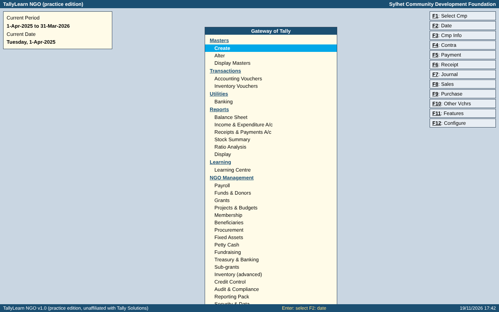

# TallyLearn NGO

A **Windows desktop practice simulator** that recreates the keyboard-driven workflow and report layouts of **Tally ERP 9**, specialised for **NGO / non-profit accounting**, with a built-in **beginner to advanced curriculum (English + Bangla)** and a pre-seeded fictional NGO, so you can practise for jobs and interviews. Fully offline.

> **Disclaimer.** Tally and Tally ERP 9 are registered trademarks of Tally Solutions. TallyLearn NGO is an independent learning tool, **not affiliated with, endorsed by or derived from** Tally Solutions. No Tally code, logos or assets are used. VAT/TDS/FD-6/FD-7 features are teaching simulations, not tax or legal advice. All data in the seed companies is fictional.



## Quick start (English)
1. Download `TallyLearn-NGO-Setup-1.0.0.exe` (installer), `TallyLearn-NGO-Portable-1.0.0.exe`, or on Linux `TallyLearn-NGO-1.0.0.AppImage` (`chmod +x` then run) from the GitHub **Releases** page. Builds are unsigned: Windows SmartScreen shows a warning on first run (*More info > Run anyway*).
2. Start the app. The first run creates three practice companies: **Sylhet Community Development Foundation** (about 600 vouchers), **Tea Garden Women Cooperative** (small) and **Blank NGO**.
3. Open **Gateway > Learning Centre**, pick lesson **B1**, and follow the coach panel on the left. `Ctrl+H` hint, `Ctrl+K` show me, `Ctrl+L` English/Bangla, `Ctrl+J` collapse, `Ctrl+/` shortcuts & glossary.
4. Everything works from the keyboard: `Enter` select/next, `Esc` back, `Ctrl+A` accept, `F4`-`F9` vouchers, `F11` features, `F12` configure, `Alt+F1` detailed view, `F2` period, `Alt+E` CSV, `Alt+P` print/PDF.
5. Finish with the **Interview Simulator** (30 timed tasks + 50 MCQ) and print your certificate.

## দ্রুত শুরু (বাংলা)
1. GitHub **Releases** থেকে `TallyLearn-NGO-Setup-1.0.0.exe` (ইন্সটলার) বা Portable ভার্সন নামিয়ে চালান। প্রথমবার Windows SmartScreen সতর্ক করলে *More info > Run anyway* চাপুন।
2. প্রথমবার তিনটি অনুশীলন কোম্পানি তৈরি হয়: **Sylhet Community Development Foundation** (প্রায় ৬০০ ভাউচার), **Tea Garden Women Cooperative** ও **Blank NGO**।
3. **Gateway > Learning Centre** খুলে **B1** পাঠ বেছে নিন। বাম পাশের কোচ প্যানেল ধাপে ধাপে দেখাবে। `Ctrl+L` চাপলে বাংলা/ইংরেজি বদলাবে; `Ctrl+H` হিন্ট; `Ctrl+K` কীভাবে করতে হয় দেখায়।
4. সবকিছু কিবোর্ড দিয়ে চলে: `Enter` পরবর্তী, `Esc` পেছনে, `Ctrl+A` গ্রহণ, `F4`-`F9` ভাউচার, `F11` ফিচার, `F12` কনফিগার।
5. শেষে **Interview Simulator** দিন (৩০টি টাস্ক + ৫০টি MCQ) এবং সার্টিফিকেট প্রিন্ট করুন।

## What is inside
| Area | Contents |
|---|---|
| Accounting engine | integer-paisa money, double entry, all voucher types, bill-wise, cost centres, optional / post-dated / memorandum, edit log |
| Tally UI | Gateway, F-key button bar, keyboard router, F11 Features, F12 Configure, companies (create / select / backup / restore / carry-forward split / repair), roles + Vault |
| Reports | Balance Sheet, I&E, R&P, Trial Balance, Day Book, ledgers, ageing, stock, ratios, fund & project statements, VAT/TDS (simulated), CSV, A4 preview, PDF |
| NGO modules | payroll, funds, donors, grants (donor report, tranches, refund), foreign donations, projects & burn rate, budgets, membership, beneficiaries, procurement 3-way match, fixed assets, petty cash, fundraising, treasury / FDR, sub-grants, credit control, audit & error lab, reporting pack |
| Learning | 52 bilingual lessons (B1-B7, I1-I8, A1-A8, C1-C8, N1-N18, E1, X1-X2), quizzes, 80% level gating, XP, interview simulator with 106 tasks and 59 MCQs, certificate |

Screenshots: [Balance Sheet](docs/screenshots/02-balance-sheet.png), [Receipt voucher](docs/screenshots/04-receipt-voucher.png), [Grant report prompt](docs/screenshots/05-grant-register.png), [Audit exceptions](docs/screenshots/07-audit-exceptions.png), [Learning Centre](docs/screenshots/08-learning-centre.png), [Coach (Bangla)](docs/screenshots/10-coach-bangla.png).

## Develop
```bash
npm ci
npm test            # engine, seed, every lesson and task is verified completable
npm run lint && npm run typecheck
npm start           # build + run in Electron
npm run dist        # NSIS installer + portable exe into release/
npm run seed        # regenerate content/seed, lessons, task bank and docs/COVERAGE.md
npm run e2e         # browser smoke test (needs: npm i -D playwright && npx playwright install chromium)
```
Release: `git tag v1.0.0 && git push --tags` builds the installer, portable exe and SHA-256 sums with GitHub Actions (`.github/workflows/release.yml`).

Project rules are in [CLAUDE.md](CLAUDE.md); differences from Tally ERP 9 are logged in [docs/DEVIATIONS.md](docs/DEVIATIONS.md); catalog coverage in [docs/COVERAGE.md](docs/COVERAGE.md); changes in [CHANGELOG.md](CHANGELOG.md).
